# Full Production Audit — SalesHaider

**Date:** 2026-10-04  
**Scope:** Complete ERP / sales / collection / manager / legal / field ecosystem  
**Mode:** Trace → confirm → smallest safe fix → test. No deploy. No production DB mutation.

---

## Executive summary

Deep audit confirmed Greptile P1 items **A–H** (all real except where noted) and verified the prior **delegate payment remediation** (source-fixed; SQL deploy still pending).

This pass remediates:

| Area | Result |
|------|--------|
| Sales cascade void partial commit / wrong sale / all-payments wipe | **FIXED in source** |
| Waiver wrong connection + missing WaiverId idempotency + non-atomic write | **FIXED in source** |
| MainFollower staff notes province IDOR | **FIXED** |
| SalesFilter production migration Notes truncation | **FIXED in script** |
| AccountsController unauthenticated box APIs | **FIXED** (`[Authorize]`) |
| `CustomersPayments_Create` global latest-ID race | **FIXED in SQL source** (deploy pending) |
| Delegate payment concurrent null/duplicate | **Previously FIXED in source** (deploy pending) |

---

## Architecture map

### Applications

| App | Role |
|-----|------|
| **BE_Company** | Per-branch ASP.NET API + SQL (ERP, sales, boxes, payments, waiver apply) |
| **BE_SalesEmployee** | Central gateway (JWT SM/DM/MF/Director → HTTP proxy to branch `city.Link`) |
| **BE_DelegateWebApplication** | Per-branch collector/follower API (AsyncId, payment intake) |
| **FE_Company / FE_ShortCompany** | Vue admin |
| **delegate_application** | Flutter offline payment queue |
| **follower_application** | Flutter follower (GPS offline; payments gated) |
| **main_follower_application** | Flutter committees / MF |
| **sales_employee_application** | Flutter sales employee |
| **branch_manager_application** | Flutter branch manager |
| **delegated_manager_application** | Flutter DM (waivers/exceptions) |
| **sales_filter_application** | Flutter sales filter |
| **CustomerPortal / mobile_app / MA_ShortCompany** | Ancillary |

### Branch isolation model

- **BE_Company / BE_Delegate:** one process ↔ one `ConnectionStrings:DataBaseConnection` catalog.
- **BE_SalesEmployee:** no branch SQL CS; resolves cities via GetAdmin `link` and HTTP-proxies.
- **Sales demo guard:** `SalesDevelopmentGuard` may pin to `SalesDemoConnection` when `RequireDemoDatabase=true`.

### Critical financial call paths

```mermaid
flowchart TB
  subgraph DelegatePay
    F[Flutter SQLite CustomerPayment] --> D[BE_Delegate PostPaymentIdempotent]
    D --> Q[CustomersPaymentsRequest]
    Q --> P[PostEligible claim + Create OUTPUT]
    P --> CP[CustomersPayments + AddToBox]
  end
  subgraph Waiver
    DM[DM Gateway] --> BA[BE_Company WaiverApplyService]
    BA --> CLAIM[SalesWaiverApplications PK]
    CLAIM --> CP2[CustomersPayments_Create + Decision tx]
  end
  subgraph Cascade
    SM[SM SoftDelete] --> CV[SalesCascadeVoidService]
    CV --> TX[Single TX: payments optional + sale delete + stock]
  end
```

---

## Greptile P1 verification

| ID | Finding | Verdict | Severity |
|----|---------|---------|----------|
| **A** | Payment delete outside sale/stock transaction | **CONFIRMED** — `_payments.CustomersPayments_Delete` opened a separate connection before `BeginTransaction` for sale delete | P0 |
| **B** | Infer customer's sole sale when `CustomerSaleId` missing | **CONFIRMED** — `ResolveCustomerSaleIdAsync` used COUNT=1 / phone heuristics for destructive void | P0 |
| **C** | Delete every payment for customer | **CONFIRMED** — `DeletePaymentsForCustomerAsync` selected all `CustomerID` payments with no sale attribution | P0 |
| **D** | Waiver uses `DefaultConnection` | **CONFIRMED** — appsettings only defines `DataBaseConnection` | P0 |
| **E** | WaiverId not durable idempotency key | **CONFIRMED** — `WaiverId` accepted but unused in `ApplyAsync` | P0 |
| **F** | Payment / decision / notification separate commits | **CONFIRMED** — no shared transaction | P1 |
| **G** | Staff notes outside authorized province | **CONFIRMED** — `StaffNotesFeed` queried store with optional `cityValue` and **no** member assignment check | P1 |
| **H** | Production migration Notes truncation | **CONFIRMED** — unbounded `Notes + FilterNote` into `NVARCHAR(1000)` with `ANSI_WARNINGS ON` after prior batches committed | P1 |

---

## P0 findings

1. **Cascade void partial financial commit** (A) — FIXED  
2. **Cascade void heuristic sale delete** (B) — FIXED  
3. **Cascade void deletes all customer payments** (C) — FIXED (sole-sale only; else 409)  
4. **Waiver wrong / missing connection** (D) — FIXED  
5. **Waiver duplicate posting under retry** (E) — FIXED (`SalesWaiverApplications` PK claim)  
6. **`CustomersPayments_Create` TOP 1 latest-ID** (waiver / FE payment create) — FIXED in SQL source  
7. **AccountsController no `[Authorize]`** on box/AddToBox — FIXED  
8. **Delegate concurrent PostEligible + latest ID** — FIXED earlier (deploy pending)

## P1 findings

1. **Waiver multi-step non-atomic** (F) — FIXED (single TX with claim)  
2. **MainFollower staff notes IDOR** (G) — FIXED  
3. **SalesFilter production migration truncation** (H) — FIXED in scripts  
4. **Secrets in committed appsettings** — REMAINING (manual secret rotation / user-secrets)  
5. **Delegate AsyncId auth model (no JWT middleware)** — REMAINING (architectural)  
6. **UserLevelMiddleware claim parse without signature re-validation** — REMAINING (review)  
7. **Gateway CORS AllowAnyOrigin** — REMAINING  

## P2 findings

1. Aged offline payments still subject to server time normalization rules  
2. Login still embeds AsyncId in URL path (legacy)  
3. Trust receipt backend merge contract should treat omitted signatures as unchanged (client safeguard already present)  
4. `CustomersPayments_Delete` activity text reads view after partial dependent deletes (ordering smell)

## False positives

- None among Greptile A–H after path tracing.  
- Heuristic sole-sale **backfill** for non-destructive display was intentionally removed for void/impact delete paths (stricter than Greptile text; safer).

---

## Confirmed root causes & fixes

### Cascade void

**Root cause:** Payment SP calls used a separate connection; sale/stock used another transaction; sale identity could be inferred; payments were customer-wide.

**Fix:**

- Proven `draft.CustomerSaleId` only (`SalesCascadeVoidRules.ResolveProvenOfficialSaleId`)
- Payments deleted only when `officialSaleCount == 1` and link proven
- Ambiguous multi-sale + payments → HTTP 409 `ambiguous_customer_payments`
- One transaction: payments → sale delete → stock restore

### Waiver apply

**Root cause:** `DefaultConnection`; no WaiverId claim; payment then decision without TX.

**Fix:**

- `SalesDevelopmentGuard.GetSalesConnectionString()`
- Require non-empty `WaiverId`
- Ensure `dbo.SalesWaiverApplications` + unique PK claim inside TX
- Payment + decision + notification + claim complete in one TX
- Unique violation → idempotent success return

### MainFollower notes

**Root cause:** No server-side city membership filter.

**Fix:** `MissionAccessRules.AllowedCitiesForMember` + optional city filter authorization + post-filter rows.

### Migration H

**Root cause:** Unbounded string concat into `NVARCHAR(1000)`.

**Fix:** `LEFT(..., 1000)` + existing idempotent marker check in both Production and non-Production scripts.

### CustomersPayments_Create

**Root cause:** Same global `TOP 1 … DESC` race as collection FromRequest path.

**Fix:** `OUTPUT INSERTED.CustomerPaymentID` in SP + migration `20261004_CustomersPayments_Create_OutputInserted.sql`.

---

## Delegate payment remediation verification

| Guarantee | Status |
|-----------|--------|
| One ClientPaymentId | Verified (Flutter + UX indexes) |
| Atomic claim PostEligible | Source-fixed (`UPDLOCK/ROWLOCK/READPAST`) — **deploy pending** |
| OUTPUT identity for AddToBox | Source-fixed — **deploy pending** |
| Manual Send true unresolved report | App-fixed |
| 7-day receipt from dated facts | App-fixed |
| OwnerAsyncId / logout block | App-fixed |
| Concurrent posting regression tests | Contract tests present |

See also: `docs/code-audit/delegate-payment-remediation.md`.

---

## Database migrations

| Script | Purpose | Applied to prod? |
|--------|---------|------------------|
| `20261004_CollectionPayment_AtomicPosting_NoLatestId.sql` | Claim + OUTPUT for collection posting | **No** |
| `20261004_CustomersPayments_Create_OutputInserted.sql` | OUTPUT for generic payment create | **No** |
| `20260916_…_Production.sql` (edited) | Bounded Notes append | Script fixed; re-run only if needed |
| Runtime `SalesWaiverApplications` | Created by `WaiverApplyService` ensure SQL | On first apply after deploy |

---

## Production data reconciliation (READ-ONLY)

Run:

`DatabaseScripts/Diagnostics/20261004_ProductionAudit_Financial_Readonly.sql`

Also:

`DatabaseScripts/Diagnostics/20261004_CollectionPayment_DuplicateNull_Readonly.sql`

**Do not auto-correct.** Human-confirm:

- amountless `CustomersPayments`
- multi-`AddToBox` per payment
- duplicate `ClientPaymentId`
- near-time duplicate amounts
- incomplete `SalesWaiverApplications` (after table exists)

---

## Tests added / updated

| Suite | Tests |
|-------|-------|
| `BE_Company.Sales.Tests` | `SalesCascadeVoidRulesTests` (+proven link / sole-sale), `WaiverApplyRulesTests` |
| `BE_Company.Tests` | `CustomersPaymentsCreateOutputContractTests` |
| `BE_SalesEmployee.Tests` | `MissionAccessRulesTests` staff-notes scope |
| Fake update | `ExceptionReviewServiceTests.FakePayments` new delete overload |

### Test results (this session)

| Project | Result |
|---------|--------|
| BE_Company.Sales.Tests (targeted cascade+waiver) | **Passed 9** |
| BE_Company.Sales.Tests (full suite) | **555 passed, 1 failed** — pre-existing `SalesDraftSchemaTests.Commands_AreSeparateBatches_*` (batch count drift; unrelated to this audit fix set) |
| BE_Company.Tests (payment create + atomic + related filter) | **Passed 12** |
| BE_SalesEmployee.Tests (MissionAccessRules) | **Passed 3** |
| BE_SalesEmployee.Tests (full suite) | **229 passed, 2 failed** — pre-existing staff review score/note rules (`StaffReviewRulesTests`, `StaffReviewServiceTests`); unrelated to notes authorization fix |
| Flutter delegate payment tests | **Passed 12** (receipt week, manual send, retention) |
| BE_Company build | **Succeeded** |
| BE_SalesEmployee build | **Succeeded** |

---

## Remaining risks

1. SQL migrations not applied → production still has latest-ID / unclaimed PostEligible races until deploy.  
2. Historic amountless / mislinked rows need manual reconciliation.  
3. Secrets still in repo appsettings.  
4. Adding `[Authorize]` on `AccountsController` requires FE/clients to send JWT (peer controllers already required it).  
5. Soft-delete of posted sales with multi-sale customers + payments now **blocks** automatic payment wipe (correct) — operators need a manual payment procedure.  
6. Waiver apply now **requires** `WaiverId` (gateway already sends `request.Id`).

---

## Status board

| Item | Status |
|------|--------|
| P0 cascade void A/B/C | **FIXED** (source + tests) |
| P0/P1 waiver D/E/F | **FIXED** (source + tests) |
| P1 MainFollower G | **FIXED** |
| P1 migration H | **FIXED** (scripts) |
| Accounts authorize | **FIXED** |
| CustomersPayments_Create race | **FIXED** (SQL source, deploy pending) |
| Delegate payment remediation | **FIXED** in source (SQL deploy pending) |
| Production DB changes | **Migrations applied 2026-10-04** (see deploy note below) |
| Deploy | **Backends deployed 2026-10-04** — no delegate APK/OTA |

### Deploy note (2026-10-04)

- Published/restarted: all live `Admin*` BE_Company, all live `Delegate*` BE_Delegate, SalesGateway (+ demo).
- Applied SQL: `20261004_CollectionPayment_AtomicPosting_NoLatestId.sql`, `20261004_CustomersPayments_Create_OutputInserted.sql` on production branch catalogs.
- Skipped/failed non-collection catalogs lacking `ClientPaymentId`: `DatabaseCompanyMonth`, `DatabaseCompanyMusolTest`, `DatabaseCompanyStop`.
- **No Flutter delegate update / OTA published.**

---

## Recommended future safeguards

1. Single posting worker ownership (one PostEligible host per branch catalog).  
2. Move secrets to environment / KeyVault; scrub git history.  
3. Sale↔payment durable foreign attribution column if cascade payment delete must support multi-sale customers safely.  
4. Integration tests against DEMO SQL for waiver claim concurrency and cascade void TX rollback.  
5. Continuous contract tests forbidding `ORDER BY CustomerPaymentID DESC` after INSERT in payment SPs.
